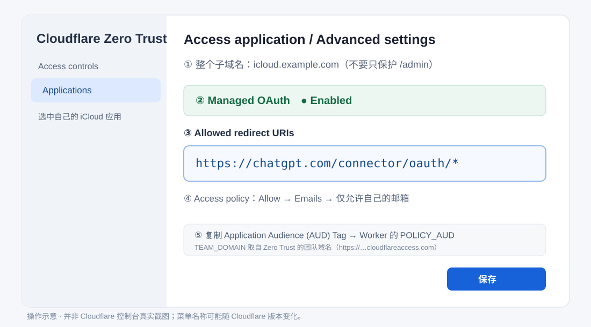
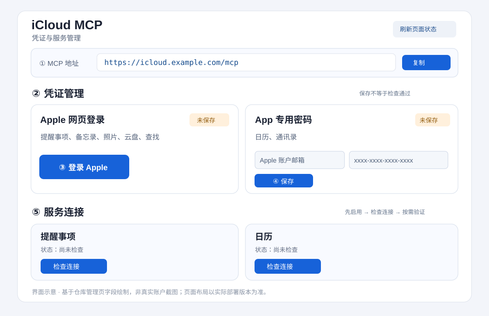

# 从零部署与使用 iCloud MCP Worker（图解版）

[返回中文 README](../README.md) · [English](../README.en.md)

**普通用户推荐流程：Fork GitHub 仓库 → Cloudflare 导入并部署 → 绑定域名 → 配置 Access / OAuth → 填写 3 个运行时变量 → 管理页登录 Apple → 在 ChatGPT 添加 MCP。**

不需要 Mac、VPS、R2，不用在本地安装 Node.js / Wrangler，也不用手动编译代码。首次部署通常只需要 Cloudflare 和 GitHub 的网页操作。本文以 `icloud.example.com` 为**示例域名**，请替换成自己的域名。

> 这是非 Apple 官方项目，使用 Apple 非公开网页协议；更新可能影响兼容性。示意图根据当前仓库的页面字段绘制，不是真实 Cloudflare 控制台或个人账户截图。**全部 Apple 凭证只在自己部署的管理页输入，不要上传到 GitHub、聊天、截图或 Worker 环境变量。**

## 开始前准备

- 一个 GitHub 账号、一个 Cloudflare 账号（可进入 Workers 和 D1）。
- 一个已托管在 Cloudflare 的域名，用来设置专用子域名，例如 `icloud.example.com`。本项目的默认配置关闭了 `workers.dev` 公共入口，因此不能只依赖 `*.workers.dev` 访问。
- 可以收到 Cloudflare Access 登录验证的邮箱，以及可以正常完成可信设备验证的 Apple 账户。
- 只有需要**日历/通讯录**时才需要 Apple 的 [App 专用密码](https://support.apple.com/en-us/102654)。

## 第 1 步：Fork 项目到自己的 GitHub

1. 打开 [项目仓库](https://github.com/happy2first/icloud-mcp-worker)。
2. 右上角点击 **Fork → Create a new fork**，选择自己的 GitHub 账号。
3. 仓库名建议保持 `icloud-mcp-worker`，直接创建。无需下载项目，也无需修改代码。

> Cloudflare Worker 的名称应与仓库 `wrangler.toml` 中的 `name = "icloud-mcp-worker"` 一致。普通部署直接沿用即可。

## 第 2 步：在 Cloudflare 导入 GitHub 仓库

1. 进入 [Cloudflare Dashboard](https://dash.cloudflare.com/) → **Workers & Pages** → **Create application**。
2. 找到 **Import a repository / 导入仓库**，选择 GitHub 并按提示授权 Cloudflare 读取你的 Fork。
3. 选择 `<你的 GitHub 用户名>/icloud-mcp-worker`，生产分支使用 `main`，项目根目录保持默认。
4. 检查构建设置：

   | 设置 | 填写值 |
   | --- | --- |
   | Worker 名称 | `icloud-mcp-worker` |
   | Build command / 构建命令 | `npm run build` |
   | Deploy command / 部署命令 | `npm run deploy:cloud` |
   | Root directory / 根目录 | 默认（仓库根目录） |
   | Production branch / 生产分支 | `main` |

5. 点击 **Save and Deploy**，打开 **Builds** 查看结果。`npm run deploy:cloud` 会部署 Worker 并执行 `schema.sql` 初始化 D1 数据表；仓库 `wrangler.toml` 使用 `DB` 绑定和数据库名 `icloud-mcp-worker`，支持按名称复用/创建数据库。

如果平台要求先创建 Worker 再关联代码：先创建名为 `icloud-mcp-worker` 的 Worker，再到 **Settings → Builds → Connect** 连接 Fork，并填写同样的两个命令。**无需同时配置两种部署方式。**

**第一次部署失败怎么办？** 看构建日志：如果报 D1 创建或绑定权限错误，先检查 Workers Builds 使用的 API Token 是否有对应 D1 权限，或在 Cloudflare **Storage & Databases → D1** 创建名为 `icloud-mcp-worker` 的数据库后重试。不要填假的 `database_id`，也不要随意删除已投入使用的数据库。

官方参考：[Cloudflare GitHub 部署](https://developers.cloudflare.com/workers/ci-cd/builds/) · [构建配置](https://developers.cloudflare.com/workers/ci-cd/builds/configuration/)

## 第 3 步：给 Worker 绑定自己的域名

1. 打开刚部署的 Worker，进入 **Settings → Domains & Routes**（有些新版界面在 **Domains** 选项卡）。
2. 点击 **Add → Custom Domain**，输入 `icloud.example.com`，确认创建。
3. 等待 Cloudflare 自动完成 DNS/HTTPS 绑定。**不需要另外手动创建重复的 CNAME**。
4. 检查 Worker 对应子域名是唯一预期入口，`workers.dev` / Preview URL 保持关闭。

后面访问的地址固定是：

- 管理页：`https://icloud.example.com/admin`
- MCP：`https://icloud.example.com/mcp`（实际以管理页顶部生成的地址为准）

此时**不要急着用 Apple 登录**：必须先完成下面的 Access 和加密 Secret 配置。

官方参考：[Custom Domains](https://developers.cloudflare.com/workers/configuration/routing/custom-domains/)

## 第 4 步：创建 Cloudflare Access 应用

本项目依靠 Cloudflare Access 保护**整个域名**，而不只是管理页。它同时为 ChatGPT 等 MCP 客户端提供 OAuth 授权。

1. 打开 Cloudflare **Zero Trust → Access controls → Applications**。
2. 新建应用，选择 **Self-hosted / 自托管应用**（或可用的 MCP server application），填写应用名称如 `iCloud MCP`。
3. 保护的域名设置为 `icloud.example.com`，**不限定路径**。这样 `/admin`、`/connect/apple`、`/mcp` 和下载接口全都受到保护。
4. 建立 **Allow** 策略，Include 只填自己的邮箱（或明确授权的身份）；不要选择 `Everyone`，也不要创建 Bypass 公开规则。
5. 到应用 **Advanced settings / 高级设置**，**开启 Managed OAuth**；如果界面提供动态客户端注册选项，保持启用。
6. 在 **Allowed redirect URIs / 允许的重定向 URI** 中加入下面这**一整行**：

   ```text
   https://chatgpt.com/connector/oauth/*
   ```

7. 保存应用，然后在应用的 **Additional settings** 或应用详情复制 **Application Audience (AUD) Tag**，下一步要填到 `POLICY_AUD`。



> `https://chatgpt.com/connector/oauth/*` **是允许 ChatGPT 回调的地址模式，不是你的 Worker 地址，也不是需要填入 Worker 的变量**。Cloudflare Managed OAuth 官方支持以 `/*` 匹配子路径。只添加你实际使用的客户端回调范围；不要设置 `https://*` 这样的宽泛许可。这个 OAuth 是**ChatGPT → 你的 MCP** 的授权，与 Apple 的可信设备验证是两回事。

建议保持 OAuth 的短 Access token 生命周期，并根据个人使用频率设置 Grant session duration；不必手动创建第三方 OAuth Client ID / Client Secret。官方参考：[Managed OAuth](https://developers.cloudflare.com/cloudflare-one/access-controls/applications/http-apps/managed-oauth/)。

## 第 5 步：配置两个变量、一个 Secret

回到 **Workers & Pages → icloud-mcp-worker → Settings → Variables and Secrets（运行时变量和机密）**。注意**不是** `Settings → Build → Build variables`；构建时变量不会自动成为 Worker 运行时变量。

| 名称（区分大小写） | 类型 | 填写方法 |
| --- | --- | --- |
| `TEAM_DOMAIN` | 普通 Text 变量 | Cloudflare Zero Trust 的**团队域名**，例如 `https://my-team.cloudflareaccess.com`（完整 HTTPS 地址，不是 iCloud 子域名） |
| `POLICY_AUD` | 普通 Text 变量 | 第 4 步 Access 应用的 **Audience (AUD) Tag**，按原样复制 |
| `ENCRYPTION_KEYS_JSON` | **Secret**（加密值） | 随机 32 字节原始数据的标准 Base64，一般为 44 个字符；不要加引号、JSON 花括号或前缀 |

生成 Secret：只需生成**一次**，从以下命令中选择适合自己电脑的一种，**不要使用在线随机密码网站生成生产密钥**：

- macOS / Linux 终端：`openssl rand -base64 32`
- Windows PowerShell：

  ```powershell
  $bytes = New-Object byte[] 32
  [System.Security.Cryptography.RandomNumberGenerator]::Create().GetBytes($bytes)
  [Convert]::ToBase64String($bytes)
  ```

**最重要的保存规则：** 记得妥善离线备份此加密密钥。首次运行可生成新密钥；以后修改代码、重新部署必须**保持同一密钥和 D1 数据库**，否则旧凭证将无法解密。Apple 的主密码、App 专用密码、Cookie/Token 均**不在**这三个变量里配置。

添加/保存后，必要时重新执行一次部署并确认生产 Worker 使用最新的变量；不要因为构建成功就认为已完成运行时配置。

## 第 6 步：打开管理页，配置 Apple 连接

浏览器访问 `https://icloud.example.com/admin`，首先应跳到 Cloudflare Access 的验证页面；用第 4 步 Allow 策略允许的邮箱登录。

管理页顶部会显示你自己的 **MCP 地址**；下方有两张不同的凭证卡。**按需要配置，不是必须两个都填。**



### 6.1 Apple 网页登录（提醒事项 / 备忘录 / 照片 / 云盘 / 查找）

1. 在「**凭证管理 → Apple 网页登录**」点击 **登录 Apple**。
2. 在新页面选择 **iCloud 服务区域**：中国大陆（云上贵州）或国际区，必须与账户实际区域一致。
3. 填写 **Apple 账户** 和 **Apple 账户主密码**，勾选页面上的两项会话/存储授权确认后点击 **登录并验证设备**。
4. 如果 Apple 在可信设备上推送批准请求，先在设备上批准，再将显示的**六位验证码**填入浏览器页面。
5. 按页面提示返回管理页，看到「网页凭证已保存」之类的状态即可进入下一步。**保存成功不代表所有服务都已连通。**

登录页面是你自己部署的 Worker 提供的**非 Apple 官方页面**。根据项目实现，主密码在浏览器参与 SRP 证明计算，Worker 不保存主密码；Cookie/Token 则加密存储在 D1。操作前仍应确认自己信任所部署的源码与域名。

### 6.2 App 专用密码（日历 / 通讯录）

**只用到提醒事项、照片等网页版服务时，可以跳过这一段。**

1. 打开 [Apple 账户管理](https://account.apple.com/) → **登录和安全 → App 专用密码**，创建一个专用密码。
2. 回到管理页「**App 专用密码**」卡片，分别填写自己的 **Apple 账户邮箱** 与刚生成的形如 `xxxx-xxxx-xxxx-xxxx` 的密码。
3. 点击 **保存**。注意这**不是 Apple 主密码**，也不能用于「查找」验证。
4. 后续如果重置专用密码，使用该卡片 **更新凭证**，不必清空网页会话。

### 6.3 开启服务并逐项检查

1. 在「**服务连接**」区域，开启你确实需要的服务（默认停用）。
2. 先保持「允许新增与修改」等**写入权限关闭**，点击每张服务卡上的 **检查连接**。
3. 如果 Apple 提出新的**设备批准 / 数据访问（PCS）验证**，只在页面提示时完成；没有提示就不需要额外验证。
4. 「**查找**」有时会要求再次输入**同一 Apple 账户主密码**，请使用对应卡片的「验证查找」入口。该操作与普通 Apple 网页会话验证分离；遇到 `REAUTH_REQUIRED` 时先看技术详情，**不要反复重连整个账号**。
5. 逐项确认卡片的上次检查结果为成功。点击「**刷新页面状态**」只重新读取保存状态，**不等于向 Apple 重测连通性**。
6. 真正要让 AI 新增/修改日历、通讯录或提醒事项时，再单独开启相关写权限。备忘录、照片、云盘保持只读。

## 第 7 步：在 ChatGPT 添加连接

1. 在管理页顶部复制自动生成的 `https://icloud.example.com/mcp`。
2. 在支持自定义远程 MCP 的 ChatGPT 连接器/插件设置中，添加该 **MCP Server URL**。具体菜单名称随账号版本变化；选择可填写自定义 MCP URL 的入口。
3. 发起连接时，浏览器应出现 **Cloudflare Access → 登录/授权**。用你的允许邮箱完成认证，这一步不输入 Apple 密码。
4. 返回 ChatGPT，先测试 `icloud_status` 或查询一个简单的只读工具（例如 `get_reminder_lists`）。如果新增了服务端工具，客户端可能需要刷新工具列表。

**排错：** 如果提示 OAuth redirect URI 不允许，核对第 4 步的完整 `https://chatgpt.com/connector/oauth/*`；如果管理页可以进、MCP 连接失败，检查 Access 是否保护了整站并启用 Managed OAuth。如果返回 `CONFIGURATION_REQUIRED` 或 403，再核对 `TEAM_DOMAIN` 和 `POLICY_AUD`。

## 部署成功检查表

- [ ] Fork 已关联 Workers Builds，`main` 有成功构建日志
- [ ] Worker 的 `DB` D1 数据库已创建/绑定，初始化没有 SQL 错误
- [ ] 自定义 HTTPS 子域名可以访问，并由 Access 要求登录
- [ ] Access Allow 策略只允许自己的身份，Managed OAuth 已开启
- [ ] Allowed redirect URIs 包含 `https://chatgpt.com/connector/oauth/*`
- [ ] 两个 Text 变量与一个 Secret 均设置在 Worker **运行时**
- [ ] 管理页已保存所需类型的 Apple 凭证
- [ ] 已启用并**逐项检查**需要的服务（写权限按需启用）
- [ ] ChatGPT 已连接 MCP，`icloud_status` 和一个只读工具正常工作

## 常见问题

| 现象 | 应优先检查 |
| --- | --- |
| Build 报 Worker 名称不匹配 | Cloudflare Worker 名和 `wrangler.toml` 的 `name` 是否一致 |
| D1/`DB` 不存在，SQL 执行失败 | 构建日志中的数据库创建/绑定权限、`wrangler.toml` 绑定名是否为 `DB`、部署命令是否为 `npm run deploy:cloud` |
| 打开管理页出现 503 / 配置错误 | `TEAM_DOMAIN`、`POLICY_AUD`、`ENCRYPTION_KEYS_JSON` 是否设置在运行时，域名/Access AUD 是否准确 |
| 管理页没有弹出 Access 登录 | 整个自定义域名是否由正确的 Access 应用保护，是否存在 Bypass |
| MCP OAuth 失败 / 回调被拒 | Managed OAuth 是否开启，Allowed redirect URIs 是否包含正确的 ChatGPT 回调模式 |
| 网页服务显示 `REAUTH_REQUIRED` | 读取管理页错误详情，仅对需要的服务重新验证；不要先删除所有凭证 |
| 日历/通讯录不通 | App 专用密码是否有效、账号是否正确、服务是否启用并检查 |
| 密钥更新后凭证全失效 | 是否更换了旧 `ENCRYPTION_KEYS_JSON` 或切换了 D1（需恢复原密钥和原库） |
| 照片缩略图在 ChatGPT 不显示 | MCP 图片返回与客户端内联展示是两回事；先核对工具错误与客户端支持 |

## 可选：命令行部署（高级用户）

本项目**不要求**普通用户执行下面步骤。只有需要本地验证或自行管理 Wrangler 时才使用 Node.js 24+：

```bash
git clone https://github.com/happy2first/icloud-mcp-worker.git
cd icloud-mcp-worker
npm ci
npm run check
npx wrangler login
npx wrangler d1 create icloud-mcp-worker
cp wrangler.toml wrangler.local.toml
```

把创建 D1 时得到的真实 `database_id` 填入**已被 Git 忽略**的 `wrangler.local.toml`，绑定名保持 `DB`；顶层添加域名路由 `routes = [{ pattern = "icloud.example.com", custom_domain = true }]`，并配置同样的 Access 运行时变量。生成 Secret 之后继续：

```bash
npx wrangler secret put ENCRYPTION_KEYS_JSON --config wrangler.local.toml
npx wrangler d1 execute DB --remote --file schema.sql --config wrangler.local.toml
npx wrangler deploy --config wrangler.local.toml
```

**不要把个人环境配置、Secret、数据库导出或 Apple 凭证提交到 Fork。** 已有部署请复用原库与原密钥。代码更新后，Cloudflare GitHub 集成会自动监听已连接分支并重新部署。

更进一步：[英文 README](../README.en.md) · [安全说明](../SECURITY.md) · [错误与验证记录](VALIDATION.md) · [Cloudflare Managed OAuth](https://developers.cloudflare.com/cloudflare-one/access-controls/applications/http-apps/managed-oauth/)